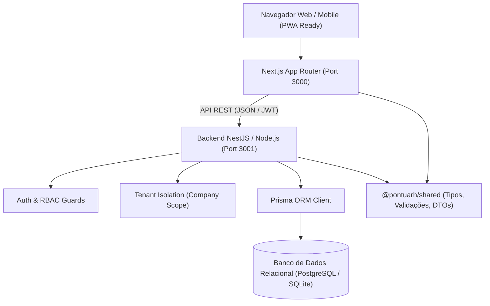
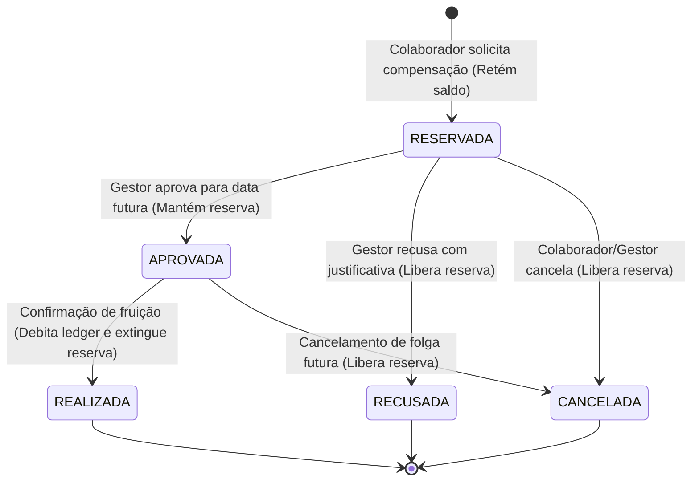
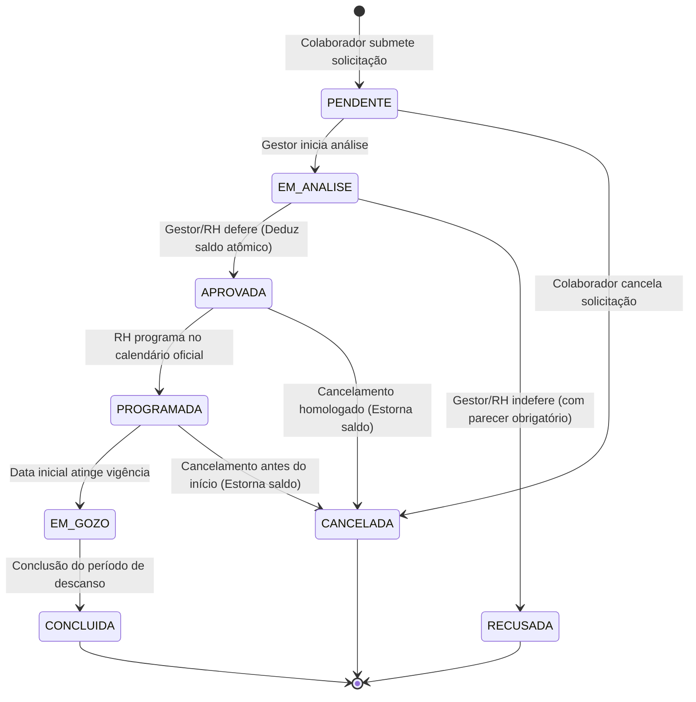

# Arquitetura do Sistema — Pontua RH

## 1. Visão Geral da Arquitetura

O **Pontua RH** foi desenhado seguindo os princípios de Arquitetura Limpa (*Clean Architecture*), Separação de Preocupações (*SoC*) e Multitenancy (*SaaS B2B*).



---

## 2. Princípios Arquiteturais

### 2.1. Multitenancy com Isolamento Estrito
- Todas as entidades operacionais possuem vínculo direto com `company_id`.
- O `TenantInterceptor` e os Guards no backend interceptam cada requisição autenticada, garantindo que usuários nunca consultem ou manipulem registros pertencentes a outra organização, mesmo manipulando IDs na URL.

### 2.2. Controle de Acesso Baseado em Papéis (RBAC)
Os perfis suportados e suas responsabilidades são:
1. `SUPER_ADMIN`: Manutenção global do sistema, provisionamento de empresas.
2. `ADMIN_EMPRESA`: Gestão integral da organização, parâmetros corporativos e relatórios.
3. `RH`: Gestão de colaboradores, admissões, jornadas, solicitações de ajuste e folha.
4. `GESTOR`: Acompanhamento de ponto da sua respectiva equipe, aprovação de ocorrências e férias.
5. `COLABORADOR`: Autoatendimento individual, marcação de ponto, consulta de espelho e solicitações.
6. `CONTADOR`: Acesso a demonstrativos de folha e relatórios fiscais sem poderes operacionais de RH.

### 2.3. Proteção e Sigilo Salarial
- Informações de remuneração (`baseSalary`, benefícios, histórico salarial) são categorizadas como dados de confidencialidade financeira.
- O backend filtra ativamente o campo salarial em consultas realizadas por perfis `COLABORADOR` ou `GESTOR` sem permissão explícita, impossibilitando vazamentos de dados via API.


### 2.4. Integridade de Ponto (Portaria MTP 671/2021)
- O horário oficial da marcação de ponto é obtido exclusivamente no servidor de aplicação (`server_timestamp`).
- Nenhuma marcação original de ponto pode ser editada ou removida fisicamente do banco de dados (imutabilidade do registro bruto).
- Ajustes e correções aprovados geram registros de ocorrência e tratamentos associados, preservando a auditoria jurídica integral.

### 2.5. Arquitetura de Banco de Horas — Ledger Transacional Imutável e Máquina de Estados
- **Ledger Contábil de Horas**: O saldo de banco de horas não é mantido como um único número mutável no banco de dados. Ele é calculado dinamicamente a partir da soma dos lançamentos do livro-razão (`TimeBankTransaction`), garantindo auditabilidade jurídica irrefutável e evitando desvios acumulados.
- **Valores Estritamente em Minutos Inteiros**: Todos os créditos, débitos e saldos são manipulados em números inteiros (minutos), eliminando inconsistências oriundas de arredondamento em float ou frações decimais de horas.
- **Imutabilidade e Estornos**: Nenhuma movimentação consolidada é removida fisicamente (`DELETE`). Erros operacionais ou retificações de ponto são corrigidos através de transações de `ESTORNO` com vínculo ao registro original (`reversedById`), lançamento de contrapartida (`AJUSTE_CREDITO` / `AJUSTE_DEBITO`) e lock explícito de linha contra estorno duplicado.
- **Máquina de Estados de Compensação (5 Estados Distintos)**:
  - `RESERVADA`: Solicitação submetida pelo colaborador. Minutos retidos preventivamente no cálculo do saldo disponível (`saldoDisponivel = saldoAtual - minutosReservados`). Nenhum débito contábil é gerado.
  - `APROVADA`: Autorizada pela chefia para fruição em data futura. **As horas continuam reservadas**, garantindo que não sejam gastas novamente ou transferidas para folha antes da data, sem gerar débito contábil prematuro no ledger.
  - `REALIZADA`: Confirmação de que a folha/saída foi efetivamente usufruída. O ledger grava a movimentação de `COMPENSACAO`, e a reserva preventiva é extinta de maneira atômica e coordenada.
  - `RECUSADA`: Indeferida pelo gestor (com parecer obrigatório). A reserva é imediatamente cancelada, restaurando o saldo disponível.
  - `CANCELADA`: Cancelamento admitido a partir dos estados `RESERVADA` ou `APROVADA` (cancelamento de folga futura previamente autorizada), liberando integralmente as horas reservadas. Transições a partir de `REALIZADA` são terminantemente bloqueadas.
- **Concorrência e Locks Transacionais no PostgreSQL**:
  - Toda movimentação financeira de horas, reserva de saldo, liquidação de folha ou estorno adquire lock explícito de linha (`SELECT id FROM "Employee" WHERE id = $1 FOR UPDATE` ou `SELECT id FROM "TimeBankTransaction" WHERE id = $1 FOR UPDATE`).
  - Prevenção de gasto duplo garantida no nível do banco de dados relacional (ACID).
  - Validação estrita de chaves de idempotência (`idempotencyKey`): retentativas idênticas retornam o registro existente; retentativas com parâmetros conflitantes resultam em rejeição com erro `409 Conflict`.
- **Recálculo Retroativo e Integração com o Ponto**:
  - Sincronização idempotente via `syncDayAdjustment`: reprocessamentos da mesma competência ou ajustes retroativos não geram créditos ou débitos duplicados.
  - Em retificações retroativas, o sistema identifica lançamentos prévios da mesma data, gera estorno auditável e contrapartida líquida, sem violar as marcações originais do REP-P e preservando horas já encaminhadas para folha de pagamento (`TRANSFERENCIA_PAGAMENTO`).
- **Visibilidade Estrita de Gestores**:
  - Filtro em nível de banco de dados (`where: { managerId: user.employeeId }`) em `/api/time-bank/balances`, bloqueando qualquer acesso a funcionários de outras equipes, departamentos ou empresas.



### 2.6. Arquitetura de Férias, Afastamentos, Sigilo Clínico e Gestão Documental (Fase 4)
- **Motor de Cálculo de Férias Desacoplado (`VacationsCalculationService`)**:
  - Implementa as regras da CLT para delimitação exata de períodos aquisitivos (12 meses a partir da admissão) e concessivos (12 meses subsequentes).
  - Tabela progressiva de faltas injustificadas (CLT Art. 130).
  - Validação de fracionamento em até 3 frações (CLT Art. 134 § 1º: período maior >= 14 dias, frações >= 5 dias).
  - Vedação estrita de início nos 2 dias que antecedem o DSR (CLT Art. 134 § 3º).
  - Cálculo de remuneração bruta preliminar: dias de gozo + 1/3 constitucional (CF/88 Art. 7º XVII) + abono pecuniário (CLT Art. 143: até 10 dias / 1/3) com 1/3 adicional sobre o abono, com ressalva legal explícita de cálculo líquido definitivo na folha (Fase 5).
- **Máquina de Estados de Férias (8 Estados)**:
  - `PENDENTE`: Submetida pelo colaborador no portal.
  - `EM_ANALISE`: Sob verificação do gestor/RH.
  - `APROVADA`: Homologada administrativamente; deduz dias do período aquisitivo de forma atômica (`daysRemaining -= days`).
  - `PROGRAMADA`: Integrada ao cronograma operacional da organização.
  - `EM_GOZO`: Período em fruição real na data.
  - `CONCLUIDA`: Período encerrado com sucesso.
  - `RECUSADA`: Rejeitada com justificativa registrada (sem impacto no saldo).
  - `CANCELADA`: Cancelada antes da fruição, estornando atomicamente os dias deduzidos de volta ao `daysRemaining`.



- **Integração Não Invasiva com Apuração de Ponto e Banco de Horas**:
  - `TimesheetService` consulta períodos de férias e licenças ativas do colaborador durante a competência.
  - Dias cobertos por férias ou licença médica são anotados como ausências autorizadas, suprimindo falsas ocorrências de `Falta Integral` e impedindo débitos indevidos no banco de horas.
  - Marcações eletrônicas de ponto originais existentes permanecem 100% preservadas e intocadas.
  - O serviço de compensação (`TimeBankService`) valida previamente se a data pretendida conflita com férias ou licenças aprovadas, rejeitando com erro `400 Bad Request`.
- **Sigilo Clínico em Atestados Médicos (LGPD e CFM)**:
  - Resolução CFM nº 1.658/2002 e LGPD: Diagnósticos e códigos CID-10 constituem dados pessoais sensíveis de saúde.
  - O backend omite o campo `cidCode` em consultas efetuadas por gestores departamentais sem perfil explícito de RH ou médico do trabalho.
  - A aprovação de atestado pelo RH gera automaticamente um registro correspondente de afastamento (`EmployeeLeave`).
- **Guarda Documental Segura**:
  - Documentos e anexos de atestados são persistidos em diretório isolado fora da raiz pública (`storage/documents/<companyId>/<employeeId>`).
  - Downloads protegidos pelo endpoint autenticado `GET /api/documents/:id/download`, validando permissão de tenant e alçada hierárquica.

---

## 3. Divisão de Pacotes no Monorepo

```
RH_ADM/
├── apps/
│   ├── frontend/            # Aplicação Web (Next.js 14 App Router, Tailwind, Lucide React)
│   │   ├── app/
│   │   │   ├── admin/       # Dashboard administrativo, colaboradores, ponto, time-bank, vacations
│   │   │   ├── portal/      # Portal do colaborador, marcação, espelho, time-bank, vacations
│   │   │   └── login/       # Autenticação e seleção de perfil
│   │   ├── components/      # Componentes UI reutilizáveis, modais e layouts
│   │   ├── hooks/           # Hooks personalizados de autenticação e dados
│   │   └── lib/             # Cliente API, utilitários de formatação e temas
│   └── backend/             # API REST (NestJS / TypeScript)
│       ├── src/
│       │   ├── auth/        # Módulo de Autenticação, JWT, Password Hash, Guards
│       │   ├── companies/   # Gestão de Empresas e Unidades (Multitenancy)
│       │   ├── employees/   # Gestão e ciclo de vida de colaboradores
│       │   ├── schedules/   # Jornadas de trabalho, escalas e tolerâncias
│       │   ├── time-tracking/# Registro eletrônico de ponto (Portaria 671)
│       │   ├── timesheet/   # Motor de apuração de jornada e espelho de ponto
│       │   ├── adjustments/ # Solicitações e deliberação de ajustes de ponto
│       │   ├── time-bank/   # Banco de horas, ledger transacional, políticas e compensações
│       │   ├── vacations/   # Períodos de férias, motor de cálculo CLT, workflow de solicitações
│       │   ├── leaves/      # Gestão de afastamentos legais, licenças e previsões de retorno
│       │   ├── medical-certificates/ # Atestados médicos com sigilo CID-10 e homologação
│       │   ├── documents/   # Prontuário digital e guarda documental protegida
│       │   ├── prisma/      # Prisma Client Service e Repositório
│       │   └── common/      # Decorators, Interceptors, Tratamento de Exceções
│       └── prisma/
│           ├── schema.prisma # Modelagem relacional completa (com shadowDatabaseUrl)
│           ├── migrations/  # Migrações versionadas do PostgreSQL
│           └── seed.ts      # Dados iniciais para testes e desenvolvimento
└── packages/
    └── shared/              # Código isomórfico (Front + Back)
        ├── src/
        │   ├── types/       # Interfaces e Tipagens de Domínio (Ponto, Banco de Horas, Férias)
        │   ├── enums/       # Enums (Perfis, Operações, Férias, Afastamentos, Documentos)
        │   └── validators/  # Validações Zod (CPF, CNPJ, Telefone BR)
```


