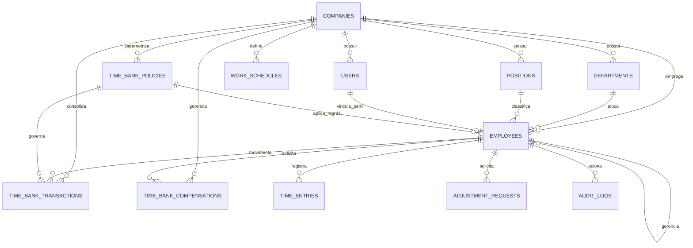

# Modelagem do Banco de Dados — Pontua RH

Este documento descreve a arquitetura de dados relacional mapeada no **Prisma ORM**, abrangendo as tabelas ativas da **Fase 1 (Fundação)** e a modelagem estruturada para suporte às fases futuras (Ponto, Banco de Horas, Férias, Folha).

---

## 1. Diagrama Entidade-Relacionamento (ERD)

---

## 2. Dicionário de Dados — Fase 1 (Ativa)

### 2.1. `Company` (Empresas - Multitenancy)
| Campo | Tipo | Nulo | Descrição |
|---|---|---|---|
| `id` | String (UUID/cuid) | Não | Identificador único da empresa contratante |
| `name` | String | Não | Razão Social |
| `tradeName` | String | Sim | Nome Fantasia |
| `cnpj` | String (Unique) | Não | CNPJ formatado ou numérico |
| `email` | String | Sim | E-mail corporativo institucional |
| `phone` | String | Sim | Telefone de contato |
| `active` | Boolean | Não | Situação da conta da empresa (default: true) |
| `createdAt` | DateTime | Não | Registro de criação |
| `updatedAt` | DateTime | Não | Última alteração |

### 2.2. `User` (Usuários e Autenticação)
| Campo | Tipo | Nulo | Descrição |
|---|---|---|---|
| `id` | String (UUID/cuid) | Não | Identificador único do usuário |
| `companyId` | String | Sim | FK da empresa (nulo para SUPER_ADMIN global) |
| `name` | String | Não | Nome de exibição |
| `email` | String (Unique) | Não | E-mail para autenticação |
| `passwordHash` | String | Não | Hash da senha (bcrypt) |
| `role` | Enum (`UserRole`) | Não | SUPER_ADMIN, ADMIN_EMPRESA, RH, GESTOR, COLABORADOR, CONTADOR |
| `active` | Boolean | Não | Status do login |
| `createdAt` | DateTime | Não | Data de criação |

### 2.3. `Employee` (Colaboradores e Contratos)
| Campo | Tipo | Nulo | Descrição |
|---|---|---|---|
| `id` | String (UUID/cuid) | Não | Identificador único do colaborador |
| `companyId` | String | Não | FK da empresa empregadora (Multitenancy) |
| `userId` | String (Unique) | Sim | FK opcional do usuário associado |
| `fullName` | String | Não | Nome completo civil |
| `cpf` | String (Unique) | Não | Cadastro de Pessoas Físicas (validado) |
| `email` | String | Não | E-mail de contato / funcional |
| `phone` | String | Sim | Telefone / Celular |
| `birthDate` | DateTime | Sim | Data de nascimento |
| `registrationNumber` | String | Sim | Matrícula funcional no RH |
| `departmentId` | String | Sim | FK do departamento |
| `positionId` | String | Sim | FK do cargo |
| `managerId` | String | Sim | FK auto-relacionada do gestor direto |
| `admissionDate` | DateTime | Não | Data oficial de admissão |
| `contractType` | Enum (`ContractType`)| Não | CLT, PJ, ESTAGIO, TEMPORARIO |
| `status` | Enum (`EmployeeStatus`)| Não| ATIVO, INATIVO, AFASTADO, FERIAS |
| `baseSalary` | Float | Sim | Salário base bruto (acesso restrito por RBAC) |
| `workScheduleId` | String | Sim | FK da jornada contratual de trabalho |

### 2.4. `Department` e `Position` (Organização)
- `Department`: `id`, `companyId`, `name`, `code`, `createdAt`.
- `Position`: `id`, `companyId`, `title`, `cboCode`, `description`, `createdAt`.

---

## 3. Modelos Ativos da Fase 2 (Ponto Eletrônico e Jornadas)

### 3.1. `WorkSchedule` (Jornadas e Escalas)
| Campo | Tipo | Descrição |
|---|---|---|
| `id` | String (CUID) | Identificador da jornada |
| `companyId` | String (FK) | Empresa detentora da escala |
| `name` | String | Nome descritivo (ex: Comercial Padrão 44h) |
| `type` | String | FIXA, FLEXIVEL, ESCALA_12X36, ESCALA_6X1, ESCALA_5X2 |
| `dailyHours` | Float | Carga horária diária prevista em horas decimais (ex: 8.8) |
| `weeklyHours` | Float | Carga horária semanal total (ex: 44.0) |
| `expectedEntry` | String | Horário previsto de entrada (HH:MM) |
| `expectedExit` | String | Horário previsto de saída (HH:MM) |
| `expectedBreak` | String | Duração ou intervalo previsto (HH:MM) |
| `daysOfWeek` | String | Dias trabalhados (ex: MON,TUE,WED,THU,FRI) |
| `toleranceMinutes` | Int | Tolerância diária da CLT Art. 58 § 1º (padrão: 10 min) |
| `validFrom` / `validUntil` | DateTime? | Período de vigência da escala |
| `nightShift` | Boolean | Sinaliza jornada noturna ou travessia de meia-noite |
| `breakFlexible` | Boolean | Permite intervalo flexível |
| `active` | Boolean | Situação cadastral da jornada |

### 3.2. `TimeEntry` (Registro Eletrônico de Ponto - REP-P)
| Campo | Tipo | Descrição |
|---|---|---|
| `id` | String (CUID) | Identificador único da batida |
| `companyId` | String (FK) | Empresa contratante (Multitenancy estrito) |
| `employeeId` | String (FK) | Colaborador titular da marcação |
| `timestamp` | DateTime | Timestamp inviolável determinado pelo servidor de aplicação |
| `timezone` | String | Fuso horário oficial registrado (`America/Sao_Paulo`) |
| `type` | Enum | ENTRADA, INTERVALO_SAIDA, INTERVALO_RETORNO, SAIDA, MARCACAO_ADICIONAL |
| `origin` | String | Canal de captura (WEB, MOBILE, REP, WEB_AJUSTE_APROVADO) |
| `location` / `ipAddress` | String? | Metadados de auditoria e rede |
| `originalRecord` | Boolean | **Imutabilidade**: `true` para marcações brutas; nunca sobrescrito |
| `isTreated` | Boolean | `true` para tratamentos originados de ajustes aprovados pelo gestor |
| `treatmentType` | String? | Categoria do ajuste aplicado |
| `adjustmentRequestId` | String? (FK) | Vínculo com a solicitação deferida |
| `idempotencyKey` | String? (Unique) | Chave de idempotência unívoca para prevenção atômica de duplicações |
| `hashIntegrity` | String | Hash criptográfico SHA-256 encadeado para auditoria fiscal (distinto de assinatura ICP-Brasil) |

### 3.3. `TimeAdjustmentRequest` (Solicitações de Ajuste e Justificativas)
| Campo | Tipo | Descrição |
|---|---|---|
| `id` | String (CUID) | Identificador da solicitação |
| `companyId` | String (FK) | Empresa contratante |
| `employeeId` | String (FK) | Colaborador solicitante |
| `date` | DateTime | Data da ocorrência ou do esquecimento |
| `type` | String | ESQUECIMENTO, HORARIO_INCORRETO, PROBLEMA_TECNICO, ATESTADO, OUTRO |
| `entryType` | String? | Tipo da batida a ser incluída/ajustada |
| `proposedTime` | String? | Horário solicitado pelo empregado (HH:MM) |
| `justification` | String | Justificativa detalhada do trabalhador |
| `attachmentUrl` | String? | Comprovante, atestado ou declaração em anexo |
| `idempotencyKey` | String? (Unique) | Chave de idempotência para submissão confiável |
| `status` | Enum | PENDENTE, EM_ANALISE, AGUARDANDO_INFORMACOES, APROVADA, RECUSADA, CANCELADA |
| `reviewerId` | String? (FK) | Usuário (Gestor ou RH) responsável pela decisão |
| `decisionNotes` | String? | Parecer decisório / motivo em caso de recusa |
| `decidedAt` | DateTime? | Data e hora do deferimento/indeferimento |

### 3.4. `AuditLog` (Trilha de Auditoria LGPD e Trabalhista)
- Registro imutável de todas as ações de ponto, cadastros, alterações e aprovações com IP, ID do ator e timestamp do servidor.

---

---

## 4. Modelos Ativos da Fase 3 (Banco de Horas, Ledger e Compensações)

### 4.1. `TimeBankPolicy` (Políticas de Banco de Horas e Acordos)
| Campo | Tipo | Descrição |
|---|---|---|
| `id` | String (CUID) | Identificador da política |
| `companyId` | String (FK) | Empresa contratante (Multitenancy) |
| `name` | String | Nome descritivo (ex: Acordo Individual Semestral) |
| `compensationType` | String | Modalidade (ex: BANCO_HORAS_PADRAO) |
| `periodMonths` | Int | Período de vigência em meses (6 meses acordo individual CLT 59 § 5º; 12 meses CCT) |
| `validFrom` / `validUntil` | DateTime? | Intervalo de vigência temporal do acordo |
| `maxDailyCreditMinutes` | Int | Limite de crédito diário (padrão: 120 min = 2 horas extras/dia, CLT Art. 59 caput) |
| `maxNegativeBalanceMinutes`| Int | Limite de débito acumulado permitido (ex: 2400 min = 40h) |
| `allowNegativeBalance` | Boolean | Se permite saldo devedor ou bloqueia débitos |
| `creditRate` | Float | Fator multiplicador de conversão (ex: 1.0 = 100%, 1.5 = 150%) |
| `requireManagerApproval` | Boolean | Exige aprovação de chefia para compensação |
| `expiryAction` | String | Ação ao expirar vigência: `PAGAR_FOLHA`, `EXPIRAR`, `ACUMULAR` |
| `active` | Boolean | Situação ativa/inativa da regra |
| `isDefault` | Boolean | Se atua como política padrão da organização |

### 4.2. `TimeBankTransaction` (Livro de Movimentações / Ledger Transacional)
O livro é **estritamente transacional e imutável**. Nenhuma movimentação consolidada sofre exclusão física (`DELETE`). Correções ocorrem exclusivamente por estorno (`status = 'ESTORNADO'`) e lançamento compensatório correspondente (`AJUSTE_CREDITO` ou `AJUSTE_DEBITO`).

| Campo | Tipo | Descrição |
|---|---|---|
| `id` | String (CUID) | Identificador único da transação no ledger |
| `companyId` | String (FK) | Empresa proprietária do registro (Multitenancy) |
| `employeeId` | String (FK) | Colaborador titular da movimentação |
| `policyId` | String? (FK) | Política aplicada no momento do lançamento |
| `type` | Enum | `CREDITO`, `DEBITO`, `AJUSTE_CREDITO`, `AJUSTE_DEBITO`, `COMPENSACAO`, `TRANSFERENCIA_PAGAMENTO`, `ESTORNO` |
| `minutes` | Int | Quantidade em **minutos inteiros** (sem aproximações decimais de ponto flutuante) |
| `balanceAfter` | Int? | Snapshot do saldo resultante pós-operação |
| `competence` | String | Competência contábil de apuração (`AAAA-MM`) |
| `origin` | Enum | `APURACAO_PONTO`, `SOLICITACAO_COMPENSACAO`, `AJUSTE_GESTOR`, `LIQUIDACAO_FOLHA`, `FECHAMENTO_PERIODO` |
| `referenceId` | String? | Vínculo com data da jornada (`AAAA-MM-DD`), ID da compensação ou ID de estorno |
| `createdById` | String? (FK) | Usuário responsável pela operação no sistema |
| `status` | String | `CONSOLIDADO` (válido para cômputo) ou `ESTORNADO` (invalida impacto financeiro) |
| `idempotencyKey` | String? (Unique) | Chave unívoca de idempotência contra execuções financeiras concorrentes |
| `description` | String? | Memória de cálculo e justificativa descritiva |

#### Mecanismos de Concorrência e Bloqueio:
- **Bloqueio de Linha Transacional (`SELECT ... FOR UPDATE`)**: Toda operação financeira de inserção, reversão ou liquidação adquire bloqueio explícito no colaborador (`Employee`) ou na transação de referência (`TimeBankTransaction`), prevenindo condições de corrida de saldo concorrente.
- **Validação de Conteúdo em Chaves de Idempotência**: A reutilização de uma mesma chave de idempotência com conteúdo ou parâmetros divergentes resulta em rejeição com erro de conflito (`409 Conflict`), garantindo que uma chave não represente operações distintas.

### 4.3. `TimeBankCompensationRequest` (Solicitações de Folga e Compensação)
Implementa máquina de estados com **segregação formal entre Autorização e Realização**, garantindo reserva contínua de saldo até a fruição efetiva.

| Campo | Tipo | Descrição |
|---|---|---|
| `id` | String (CUID) | Identificador da solicitação |
| `companyId` | String (FK) | Empresa titular |
| `employeeId` | String (FK) | Colaborador solicitante |
| `type` | Enum | `FOLGA_INTEGRAL`, `SAIDA_ANTECIPADA`, `ENTRADA_POSTERIOR`, `REDUCAO_JORNADA` |
| `date` | DateTime | Data pretendida da folha/saída |
| `durationMinutes` | Int | Horas solicitadas em minutos inteiros |
| `justification` | String | Justificativa do trabalhador |
| `status` | Enum | `RESERVADA`, `APROVADA`, `REALIZADA`, `RECUSADA`, `CANCELADA` |
| `reviewedById` | String? (FK) | Gestor ou RH deliberante |
| `decisionNotes` | String? | Parecer da chefia (obrigatório em caso de recusa) |
| `decidedAt` | DateTime? | Data e hora da análise |
| `ledgerTransactionId`| String? (FK) | Vínculo com a movimentação consolidada no ledger (gerado apenas na Realização) |
| `idempotencyKey` | String? (Unique) | Chave de idempotência da solicitação |

#### Ciclo de Vida e Estados da Compensação:
1. `RESERVADA`: Solicitação submetida pelo colaborador. Horas retidas preventivamente no cálculo do saldo disponível (`saldoDisponivel = saldoAtual - minutosReservados`). Nenhum débito é inserido no ledger neste momento.
2. `APROVADA`: Autorizada pela chefia para data futura. **As horas permanecem reservadas preventivamente** e não geram débito imediato no ledger, impedindo que folgas futuras reduzam o saldo contábil antes de ocorrerem.
3. `REALIZADA`: Fruição confirmada na data ou homologada. O sistema gera a movimentação definitiva de `COMPENSACAO` no ledger e extingue a reserva de forma atômica e coordenada, sem duplicidade de consumo.
4. `RECUSADA`: Rejeitada pelo gestor com justificativa obrigatória. A reserva é desfeita imediatamente, restaurando o saldo disponível do colaborador.
5. `CANCELADA`: Cancelada a pedido do colaborador ou gestor antes da fruição (suportado para solicitações em estado `RESERVADA` ou `APROVADA`). A reserva é liberada integralmente. Transições a partir de `REALIZADA` são terminantemente bloqueadas sem processo formal de estorno.

---

## 4.4. Modelagem de Férias e Ausências (Fase 4)

### `VacationPeriod` (Períodos Aquisitivos e Concessivos)
Rastreia a aquisição e concessão de férias conforme os artigos 130, 134 e 137 da CLT.

| Campo | Tipo | Descrição |
|---|---|---|
| `id` | String (CUID) | Identificador do período |
| `companyId` | String (FK) | Empresa titular |
| `employeeId` | String (FK) | Colaborador titular |
| `startDate` | DateTime | Início do período aquisitivo (12 meses) |
| `endDate` | DateTime | Fim do período aquisitivo |
| `concessiveStartDate` | DateTime | Início do período concessivo |
| `concessiveEndDate` | DateTime | Limite do período concessivo (risco de dobra CLT 137) |
| `daysAcquired` | Int | Dias de direito (30d padrão com redução por faltas injustificadas CLT 130) |
| `daysUsed` | Int | Dias de férias efetivamente agendados/usufruídos |
| `daysSold` | Int | Dias convertidos em abono pecuniário (CLT Art. 143: até 10 dias) |
| `daysRemaining` | Int | Saldo disponível remanescente |
| `status` | Enum | `ABERTO`, `ADQUIRIDO`, `PROGRAMADO`, `PARCIALMENTE_USUFRUIDO`, `TOTALMENTE_USUFRUIDO`, `VENCIDO`, `PERDIDO` |
| `unjustifiedAbsences` | Int | Total de faltas injustificadas apuradas no ciclo aquisitivo |

### `VacationRequest` (Solicitações e Programações de Férias)
Gerencia o workflow de agendamento e fracionamento de férias (CLT Art. 134 § 1º e § 3º).

| Campo | Tipo | Descrição |
|---|---|---|
| `id` | String (CUID) | Identificador da solicitação |
| `companyId` | String (FK) | Empresa titular |
| `employeeId` | String (FK) | Colaborador solicitante |
| `vacationPeriodId` | String (FK) | Vínculo com o período aquisitivo de direito |
| `startDate` | DateTime | Início da fruição |
| `endDate` | DateTime | Fim da fruição |
| `daysCount` | Int | Quantidade de dias corridos (mínimo 5 dias, pelo menos um de 14d) |
| `sellDays` | Int | Dias convertidos em abono pecuniário (máx 10 dias) |
| `fractionNumber` | Int | Número do fracionamento (1, 2 ou 3) |
| `status` | Enum | `PENDENTE`, `EM_ANALISE`, `APROVADA`, `PROGRAMADA`, `EM_GOZO`, `CONCLUIDA`, `RECUSADA`, `CANCELADA` |
| `advance13th` | Boolean | Solicitação de adiantamento da 1ª parcela do 13º salário |
| `reviewedById` | String? (FK) | Gestor ou RH deliberante |
| `decisionNotes` | String? | Parecer ou justificativa obrigatória de recusa |
| `decidedAt` | DateTime? | Data e hora da deliberação |

### `EmployeeLeave` (Afastamentos e Licenças Legais)
Registro de interrupções e suspensões contratuais com previsão e retorno efetivo.

| Campo | Tipo | Descrição |
|---|---|---|
| `id` | String (CUID) | Identificador do afastamento |
| `companyId` | String (FK) | Empresa titular |
| `employeeId` | String (FK) | Colaborador titular |
| `type` | Enum | `DOENCA_ATE_15D`, `DOENCA_INSS`, `ACIDENTE_TRABALHO`, `MATERNIDADE`, `PATERNIDADE`, `CASAMENTO`, `LUTO`, `DOACAO_SANGUE`, `ALISTAMENTO_ELEITORAL`, `SERVICO_MILITAR`, `AFASTAMENTO_ADMINISTRATIVO`, `OUTROS` |
| `startDate` | DateTime | Início do afastamento |
| `endDate` | DateTime? | Fim previsto do afastamento |
| `expectedReturnDate` | DateTime? | Data estimada de retorno ao trabalho |
| `actualReturnDate` | DateTime? | Retorno efetivo registrado pelo RH |
| `reason` | String | Justificativa ou fundamento legal |
| `cidCode` | String? | Classificação Internacional de Doenças (dado sensível LGPD/CFM) |
| `status` | Enum | `PENDENTE`, `ATIVO`, `CONCLUIDO`, `CANCELADO`, `RECUSADO` |

### `MedicalCertificate` (Atestados Médicos com Sigilo Clínico)
Homologação de atestados médicos com restrição de acesso a dados sensíveis.

| Campo | Tipo | Descrição |
|---|---|---|
| `id` | String (CUID) | Identificador do atestado |
| `companyId` | String (FK) | Empresa titular |
| `employeeId` | String (FK) | Colaborador titular |
| `startDate` | DateTime | Início do repouso médico |
| `daysOff` | Int | Quantidade de dias de afastamento |
| `doctorName` | String? | Nome do profissional de saúde |
| `crmNumber` | String? | Registro no conselho de classe médica |
| `crmState` | String? | UF do CRM |
| `cidCode` | String? | Código CID-10 (protegido contra exposição indevida sob LGPD) |
| `documentUrl` | String? | Caminho seguro do arquivo comprovante no storage |
| `status` | Enum | `PENDENTE`, `EM_ANALISE`, `APROVADO`, `RECUSADO` |

### `EmployeeDocument` (Prontuário Digital e Guarda Documental)
Repositório protegido de documentos corporativos com RBAC por perfil.

| Campo | Tipo | Descrição |
|---|---|---|
| `id` | String (CUID) | Identificador do documento |
| `companyId` | String (FK) | Empresa titular |
| `employeeId` | String (FK) | Colaborador titular |
| `category` | Enum | `DOCUMENTO_ADMISSIONAL`, `DOCUMENTO_CONTRATUAL`, `AVISO_FERIAS`, `RECIBO_FERIAS`, `ATESTADO_MEDICO`, `DECLARACAO_COMPARECIMENTO`, `OUTROS_ADMINISTRATIVOS` |
| `title` | String | Título / descrição do documento |
| `fileName` | String | Nome original do arquivo sanitizado |
| `fileKey` | String | Chave de armazenamento no disco local protegido |
| `fileSize` | Int | Tamanho em bytes |
| `mimeType` | String | Tipo MIME validado (PDF, PNG, JPG, DOCX) |
| `isConfidential` | Boolean | Se marcado, visível apenas para RH e Administrador |

---

## 5. Política de Banco de Dados e Migrações

- **SGBD Oficial Padronizado**: PostgreSQL (versões 15 a 18).
- **Ambiente Local**:
  - `docker-compose.yml`: Imagem `postgres:16-alpine` na porta 5432 com banco `pontuarh_db`.
  - Instâncias bare-metal/Windows Service locais compatíveis (`postgresql-x64-18`).
- **Controle de Versão do Esquema**:
  - Utilização estrita de **Prisma Migrate** com histórico versionado em `prisma/migrations/`.
  - Migrações aplicadas:
    - `20261024184454_init_postgresql`: Fundação e ponto eletrônico (Fases 1 e 2).
    - `20261026214257_phase3_time_bank`: Banco de Horas, Ledger Transacional, Políticas e Compensações (Fase 3).
    - `20261027020211_phase4_vacations_leaves_documents`: Férias, Afastamentos, Atestados e Repositório Documental (Fase 4).
  - Desenvolvimento: `npm run db:migrate:dev` (`prisma migrate dev`).
  - Produção e CI: `npm run db:migrate:deploy` (`prisma migrate deploy`).
  - **Proibição**: O comando `prisma db push` não deve ser utilizado para promover alterações em ambientes com dados persistidos de produção, garantindo a integridade e rastreabilidade do schema.

