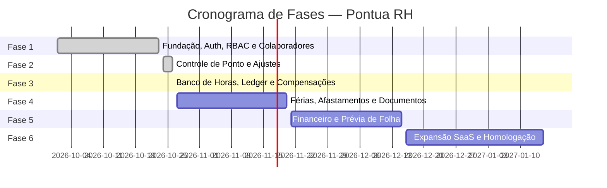

# Roadmap de Desenvolvimento — Pontua RH

Planejamento sequencial e estruturado das etapas de evolução do sistema Pontua RH.

---

## 📍 Faseamento Oficial

---

### 🟢 FASE 1 — Fundação (Status: Concluída)
- [x] Arquitetura de Monorepo com TypeScript e pacotes compartilhados.
- [x] Modelagem do banco de dados relacional com Prisma ORM.
- [x] Sistema de Autenticação com JWT assinado e Hashing de senhas seguro.
- [x] Sistema de Permissões RBAC com controle estrito no Backend e Frontend.
- [x] Isolamento de dados multiempresa (*Multitenancy*).
- [x] Gestão completa de Colaboradores (CRUD, filtros, busca, ativação/desativação).
- [x] Validação oficial de CPF (dígito verificador) e formatações brasileiras.
- [x] Proteção do sigilo salarial por perfil de acesso.
- [x] Layout Administrativo moderno (Sidebar, Header, Tema Claro/Escuro).
- [x] Portal do Colaborador com saudação e visão geral responsiva.
- [x] Testes automatizados de unidade e integração.

---

### 🟢 FASE 2 — Controle de Ponto (Status: Concluída)
- [x] Cadastro e gestão completa de jornadas de trabalho (fixas, flexíveis, 5x2, 6x1, 12x36).
- [x] Registro eletrônico de ponto com timestamp inviolável do servidor e fuso horário.
- [x] Prevenção de duplicidades (< 60s) e preservação estrita de registros originais.
- [x] Histórico de marcações do dia e comprovante eletrônico com hash SHA-256.
- [x] Serviço desacoplado de apuração da jornada (horas trabalhadas, intervalos, tolerâncias).
- [x] Identificação de inconsistências, faltas e marcações incompletas.
- [x] Espelho de ponto mensal com totalizadores e exportação em formato oficial (PDF).
- [x] Fluxo de solicitação de ajustes e inclusão de marcação esquecida pelo colaborador.
- [x] Central administrativa de análise e deliberação com visão restrita para gestores.
- [x] Aplicação de tratamentos homologados sem alteração do registro bruto original.
- [x] Suíte de 27 testes automatizados de unidade, integração e teste E2E completo.
- [x] Documentação técnica de conformidade com a Portaria MTP nº 671/2021 (REP-P).

---

### 🟢 FASE 3 — Banco de Horas, Compensações e Gestão de Jornada (Status: Concluída)
- [x] **Políticas Parametrizáveis**: Regras por empresa e departamento com vigência, tipo de compensação, limite de créditos diários e saldos negativos permitidos.
- [x] **Livro de Movimentações (Ledger Transacional)**: Registro imutável de operações (`CREDITO`, `DEBITO`, `AJUSTE_CREDITO`, `AJUSTE_DEBITO`, `COMPENSACAO`, `TRANSFERENCIA_PAGAMENTO`, `ESTORNO`). Sem deleção física.
- [x] **Cálculo de Saldos em Minutos**: Totalizadores em minutos inteiros derivados exclusivamente das movimentações ativas do ledger.
- [x] **Integração com Apuração de Ponto**: Sincronização atômica ao aprovar ajustes de espelho, recalculando saldo e gerando contrapartidas sem tocar nas marcações brutas originais.
- [x] **Máquina de Estados & Reserva Atômica**: Solicitação de compensação com bloqueio antecipado de saldo (`RESERVADA`) prevenindo consumo concorrente (gasto duplo).
- [x] **Aprovações e Cancelamentos**: Gestores/RH aprovam ou recusam com motivo obrigatório; colaboradores podem cancelar solicitações pendentes liberando o saldo reservado.
- [x] **Liquidação para Folha de Pagamento**: Mecanismo de transferência de saldo positivo para quitação em competência da folha com chave de idempotência e auditoria.
- [x] **Dashboard Administrativo**: Visão consolidada em 5 abas (Saldos por Colaborador, Livro de Movimentações / Extrato, Solicitações de Compensação, Políticas & Acordos, Transferência para Folha).
- [x] **Portal do Colaborador**: Card com saldo disponível vs. reservado, extrato de movimentações, modal de solicitação com validação em tempo real e histórico de solicitações.
- [x] **Testes Automatizados**: 70 testes unitários/integração no backend (18 cenários de negócio da Fase 3) + 2 suítes Playwright E2E completas no navegador.

---

### 🟢 FASE 3.1 — Revisão e Estabilização do Banco de Horas (Status: Concluída)
- [x] **Ciclo de Vida das Compensações (5 Estados)**: Diferenciação entre `RESERVADA`, `APROVADA`, `REALIZADA`, `RECUSADA` e `CANCELADA`. Compensação aprovada para data futura retém a reserva contínua sem débito prematuro no ledger.
- [x] **Confirmação e Realização de Fruição**: Débito consolidado de `COMPENSACAO` no ledger gerado apenas no momento da confirmação da realização, extinguindo a reserva de forma atômica.
- [x] **Cancelamento de Folga Aprovada**: Suporte a cancelamento de compensações previamente autorizadas (`APROVADA`), restituindo imediatamente os minutos reservados ao saldo disponível.
- [x] **Vencimento de Saldos sem Expurgo Automático**: Sinalização de expiração (`isExpired: true`, `expiryNotice`) e proximidade (`daysUntilExpiry <= 30`), com bloqueio estrito de baixas ou expurgo de saldos positivos sem regra administrativa ou negociação sindical validada.
- [x] **Permissões e Visibilidade Estrita de Gestores**: Auditoria e restrição de `GET /api/time-bank/balances`, `GET /api/time-bank/balances/:employeeId` e `GET /api/time-bank/transactions` exclusivamente aos subordinados diretos (`managerId == user.employeeId`), impedindo vazamentos interdepartamentais ou cross-company.
- [x] **Contabilização Idempotente e Recálculo Retroativo**: Sincronização retroativa segura (`syncDayAdjustment`) com estorno auditável de marcações retificadas, sem gerar lançamentos duplicados e protegendo horas enviadas para folha de pagamento.
- [x] **Concorrência e Locks Transacionais**: Bloqueio de linha PostgreSQL (`SELECT ... FOR UPDATE`) em operações financeiras e de reserva, garantindo isolamento ACID contra duplo consumo concorrente de saldo e estorno duplicado.
- [x] **Validação de Idempotência com Detecção de Conflito**: Prevenção de duplicidade com rejeição (`409 Conflict`) em caso de payload conflitante para a mesma chave de idempotência.
- [x] **Proteção contra Duplo Clique Físico**: Verificação de duplicidade por `createdAt` recente, prevenindo que marcações de ajuste retroativo interfiram nas marcações em tempo real.
- [x] **Bateria Completa de Testes**: 70 testes automatizados no vitest cobrindo os 18 cenários de estabilização da Fase 3.1 + fluxo E2E completo de 10 passos no Playwright.

---

### 🟢 FASE 4 — Gestão de Férias, Afastamentos, Atestados e Documentos (Status: Concluída)
- [x] **Acompanhamento de Períodos Contratuais**: Cálculo automatizado de Período Aquisitivo (12 meses, CLT Art. 130) e Concessivo (12 meses subsequentes, CLT Art. 134), com tabela progressiva de redução de dias por faltas injustificadas.
- [x] **Detecção de Riscos e Dobra Legal**: Sinalização de proximidade de vencimento (`daysUntilExpiry <= 60`) e alerta preventivo de dobra da remuneração de férias (CLT Art. 137).
- [x] **Motor de Cálculo de Férias**: Serviço desacoplado e 100% testável com simulação em tempo real de dias de gozo, 1/3 constitucional (CLT Art. 129), abono pecuniário (CLT Art. 143: conversão de até 1/3 ou 10 dias) e prévia preliminar bruta com aviso explícito de apuração líquida definitiva na folha (Fase 5).
- [x] **Fracionamento Trabalhista**: Validação rigorosa do Art. 134 § 1º da CLT: até 3 períodos de fruição, com ao menos um não inferior a 14 dias e nenhum menor que 5 dias corridos.
- [x] **Proteção de Início Pré-DSR**: Validação do Art. 134 § 3º da CLT, vedando o início das férias nos 2 dias antecedentes a descanso semanal remunerado (DSR) ou feriados.
- [x] **Workflow Completo de Solicitações (8 Estados)**: `PENDENTE`, `EM_ANALISE`, `APROVADA`, `PROGRAMADA`, `EM_GOZO`, `CONCLUIDA`, `RECUSADA` e `CANCELADA`. Transições auditadas com deduções atômicas e estorno automático em cancelamentos.
- [x] **Integração com Apuração de Ponto**: Ausências de férias aprovadas/programadas e afastamentos ativos refletem como "Férias Remuneradas (CLT)" ou "Afastamento" no espelho de ponto, suprimindo falsas ocorrências de `Falta Integral` e impedindo débitos indevidos de banco de horas.
- [x] **Prevenção de Conflitos de Agenda**: Bloqueio de solicitações de compensação de banco de horas sobrepostas a períodos de férias ou licenças ativas, e bloqueio de férias concorrentes para o mesmo colaborador.
- [x] **Afastamentos e Licenças**: Gerenciamento de auxílio-doença (empresa até 15d / INSS), acidente de trabalho, licença-maternidade (120d), paternidade, gala/casamento, nojo/luto, alistamento eleitoral, serviço militar e afastamento administrativo com previsão e registro de retorno efetivo.
- [x] **Atestados Médicos com Sigilo Clínico (LGPD & CFM)**: Homologação de atestados com geração automática de licença vinculada e proteção de dados sensíveis (CID-10 restrito estritamente a RH e Medicina do Trabalho).
- [x] **Repositório Digital de Documentos Protegidos**: Upload e download autenticado com RBAC por empresa e colaborador (documentos admissionais, contratuais, avisos de férias, recibos, atestados), fora de diretórios públicos.
- [x] **Dashboard Administrativo**: Visão consolidada em 5 abas (`overview`, `requests`, `leaves`, `certificates`, `documents`) com métricas em tempo real e filtros avançados.
- [x] **Portal do Colaborador**: Interface responsiva para consulta de períodos, simulador de remuneração em tempo real, solicitação com fracionamento/abono, acompanhamento de status, envio de atestado e download seguro de documentos.
- [x] **Testes Automatizados**: 106 testes unitários e de integração no vitest aprovados (20 cenários de férias, CLT e conflitos) + 3 suítes completas de testes E2E no Playwright.

---

### 🟢 FASE 5 — Gestão Financeira e Prévia de Folha (Status: Concluída)
- [x] **Modelagem & Persistência Relacional**: Entidades `PayrollCompetence`, `PayrollEmployeeSummary` e `PayrollItem` criadas no Prisma e migradas para PostgreSQL, com isolamento multiempresa (`companyId`), unicidade de competência por empresa (`@@unique([companyId, competence])`) e integridade referencial em cascata.
- [x] **Gestão de Competências Mensais**: Criação, navegação e consulta de competências (`YYYY-MM`), cálculo e recálculo automatizado de prévias abertas, totalizadores consolidados e indicadores executivos.
- [x] **Composição Financeira Integrada**:
  - Salário-base contratual com divisor mensal derivado da escala semanal de trabalho (ex: 44h -> divisor 220; 40h -> divisor 200).
  - Horas extras apuradas a 50% via integração direta com espelho de ponto e marcações tratadas (`timesheetService`).
  - Quitação de banco de horas via liquidação financeira de saldo (`TimeBankTransaction`).
  - Proventos de férias e 1/3 constitucional com gozo no mês apurados via módulo de férias (`vacationsCalculationService`).
  - Rubricas manuais configuráveis (bônus, adicionais, benefícios como VT/VR/Saúde e descontos).
  - Precisão monetária decimal (`roundMoney`), sem distorções de ponto flutuante.
- [x] **Fechamento Definitivo & Imutabilidade**:
  - Homologação de fechamento de folha (`status: 'FECHADA'`) com registro de data/hora (`closedAt`), responsável (`closedById`) e notas da diretoria/RH.
  - Bloqueio estrito de novos lançamentos manuais, exclusões ou recálculos em competências fechadas.
  - Trilha de auditoria permanente (`AuditLog`) registrando homologação e alterações.
- [x] **Isolamento Multiempresa & Sigilo Salarial (RBAC)**:
  - Proteção de endpoints e serviços via `authGuard` e `rolesGuard`: acesso restrito estritamente a perfis com alçada financeira (`ADMIN_EMPRESA`, `RH`, `CONTADOR`).
  - Bloqueio completo de acesso ao módulo financeiro por `COLABORADOR` e `GESTOR`.
  - Consultas e mutações estritamente escopadas por `companyId`.
- [x] **Exportação Contábil em CSV**:
  - Geração de relatório consolidado em formato CSV compatível com Microsoft Excel (codificação UTF-8 com BOM `\uFEFF`, separador `;`).
  - Colunas completas: Matrícula, Colaborador, CPF, Departamento, Cargo, Salário Base, Horas Extras, Banco de Horas, Férias, Outros Proventos, Total Proventos, Descontos e Salário Líquido, além de linha de totais gerais.
- [x] **Frontend Funcional e Moderno**:
  - Interface desenvolvida em Next.js App Router (`apps/frontend/src/app/admin/payroll/page.tsx`), substituindo o antigo placeholder.
  - Seletor dinâmico de competências com navegação mês a mês e identificador de status (Aberta / Fechada).
  - 4 StatCards de KPIs financeiros (Total Bruto, Descontos, Líquido Estimado, Colaboradores Processados).
  - Tabela responsiva com busca textual (nome, CPF, matrícula) e filtro por departamento.
  - Modal individual de demonstrativo com detalhamento de rubricas, origem (Sistema vs. Manual), form para inclusão de lançamentos manuais e exclusão de itens em competência aberta.
  - Modal de confirmação de fechamento com alertas de irreversibilidade e justificativa.
  - Estados elegantes de carregamento (`Loader2`), estados vazios (`EmptyState`) e feedbacks visuais (`CheckCircle2`, `AlertCircle`).
- [x] **Bateria de Testes Automatizados**:
  - 16 testes de unidade e integração no Vitest (`apps/backend/test/payroll.test.ts`) cobrindo cálculo de prévia, apuração de horas extras, adição e remoção de proventos/descontos, recálculo atômico de totais, fechamento definitivo e imutabilidade, isolamento multiempresa e exportação CSV.
  - 100% de sucesso na suíte completa do backend (122 testes em 12 arquivos de teste).
  - Validação estrita de tipos com `tsc --noEmit` no backend e no frontend, e build de produção Next.js finalizado com sucesso.

---

---

### 🟢 FASE 6.1 — Painel Super Admin e Gestão de Empresas (Status: Concluída)
- [x] **Modelo de Dados & Migração Versionada (`Company` & `User`)**:
  - Migração Prisma `20261030101500_phase6_companies_superadmin` criada e executada com `prisma migrate deploy`.
  - Novos campos na tabela `Company`: `status` (`ATIVA`, `SUSPENSA`), endereço completo (`street`, `number`, `complement`, `neighborhood`, `city`, `state`, `zipCode`), campos de suspensão (`suspensionReason`, `suspendedAt`, `suspendedById`).
  - Campo `companyId` tornado opcional no `AuditLog` para suportar auditorias globais de ações da plataforma pelo Super Admin.
  - Atualização do seed para provisionar `superadmin@pontuarh.com.br` (`SUPER_ADMIN`).
- [x] **Autenticação, Autorização e Bloqueio Operacional em Tempo Real**:
  - Middleware `authGuard` aprimorado para validar dinamicamente no banco se a empresa do usuário solicitante está ativa e não suspensa (`status: 'SUSPENSA'`).
  - Bloqueio imediato (HTTP 403 `COMPANY_SUSPENDED`) em novas requisições de empresas suspensas, inclusive para tokens JWT ativos emitidos anteriormente.
  - Perfil `SUPER_ADMIN` com acesso restrito e exclusivo a `/api/platform/*` e à área web `/super-admin/*`. Usuários de empresas (`ADMIN_EMPRESA`, `GESTOR`, `COLABORADOR`) são estritamente barrados de endpoints da plataforma.
- [x] **Backend & APIs da Plataforma (`/api/platform/*`)**:
  - `GET /api/platform/metrics`: KPIs globais (total de empresas, ativas, suspensas, colaboradores e usuários da plataforma).
  - `GET /api/platform/companies`: Listagem paginada com busca por Razão Social, Fantasia ou CNPJ e filtro por status (`ATIVA`, `SUSPENSA`).
  - `GET /api/platform/companies/:id`: Detalhes completos da empresa com contagens agregadas de colaboradores, usuários e administradores.
  - `POST /api/platform/companies`: Cadastro de empresa com validação de CNPJ (dígitos verificadores oficiais e unicidade) e criação atômica opcional do primeiro administrador em transação (`prisma.$transaction`).
  - `PUT /api/platform/companies/:id`: Atualização cadastral dos dados corporativos e de endereço da empresa.
  - `PATCH /api/platform/companies/:id/suspend`: Suspensão de empresa com registro obrigatório de justificativa e auditoria.
  - `PATCH /api/platform/companies/:id/reactivate`: Reativação de empresa restaurando o acesso operacional.
  - `GET /api/platform/companies/:id/administrators`: Listagem de administradores (`ADMIN_EMPRESA`) da empresa.
  - `POST /api/platform/companies/:id/administrators`: Criação de novo administrador vinculado à empresa com hash seguro de senha (`bcryptjs`).
  - `PATCH /api/platform/companies/:id/administrators/:adminId/status`: Ativação e desativação de administradores.
  - `POST /api/platform/companies/:id/administrators/:adminId/reset-password`: Redefinição segura de credenciais.
- [x] **Frontend do Super Admin (`/super-admin`)**:
  - Navegação e layout dedicados e isolados do painel administrativo de empresas (`SuperAdminSidebar` e `SuperAdminHeader`).
  - Proteção de rota garantindo que apenas usuários com `role === 'SUPER_ADMIN'` acessem `/super-admin/*`.
  - **Dashboard Global (`/super-admin`)**: Indicadores de empresas totais, ativas, suspensas, colaboradores e usuários da plataforma, atalhos rápidos e tabela de empresas recentes.
  - **Listagem de Empresas (`/super-admin/companies`)**: Tabela rica com busca textual, filtro por status, paginação, badges de status, modais de confirmação de suspensão (com justificativa obrigatória) e reativação.
  - **Cadastro de Empresa (`/super-admin/companies/new`)**: Formulário completo com dados da empresa, endereço corporativo e cadastro transacional opcional do primeiro administrador.
  - **Detalhes da Empresa & Gestão de Administradores (`/super-admin/companies/[id]`)**: Visão detalhada da empresa, aba de edição cadastral e aba de gestão de administradores (com listagem, criação de novo admin, toggle ativo/inativo e modal de redefinição de senha).
  - Redirecionamento inteligente na tela de login conforme o perfil do usuário (`SUPER_ADMIN` direcionado diretamente para `/super-admin`).
- [x] **Testes Automatizados & Qualidade**:
  - Suíte completa de 24 testes automatizados em `apps/backend/test/platform.test.ts` cobrindo validação de CNPJ, unicidade, criação transacional com administrador, listagem, busca, filtros, suspensão, bloqueio em tempo real de tokens de empresas suspensas, reativação e gerenciamento de credenciais.
  - 100% de aprovação na suíte de testes do backend: **146 testes aprovados em 13 arquivos de teste**.
  - TypeScript typecheck estrito sem erros (`tsc --noEmit`) no frontend e no backend.
  - Build de produção do Next.js gerado com 100% de sucesso (25 rotas estáticas e dinâmicas compiladas).

---

### 🟢 FASE 6.2 — Gestão de Planos e Assinaturas SaaS (Status: Concluída)
- [x] **Modelagem & Persistência Relacional (`Plan`, `Subscription`, `SubscriptionHistory`)**:
  - Migração Prisma `20261030104500_phase6_plans_subscriptions` gerada e aplicada via `prisma migrate deploy`.
  - Entidade `Plan`: Nome, código único (`code`), descrição, preços decimais (`monthlyPrice`, `annualPrice`), limites contratuais (`maxEmployees`, `maxUsers`, `maxAdmins`), lista de funcionalidades autorizadas (`features: PlanFeature[]`) e status ativo/inativo.
  - Entidade `Subscription`: Vínculo 1:1 único com a empresa (`companyId @unique`), periodicidade (`MENSAL`, `ANUAL`), datas de início (`startDate`) e renovação/expiração (`endDate`), status (`ATIVA`, `EM_TESTE`, `EXPIRADA`, `CANCELADA`), preço contratado congelado no momento da assinatura (`contractedPrice`).
  - Entidade `SubscriptionHistory`: Registro imutável de ciclo de vida contratual (`CRIACAO`, `ATRIBUICAO`, `TROCA_PLANO`, `RENOVACAO`, `CANCELAMENTO`, `TESTE_DEFINIDO`, `REATIVACAO`) com valores e status anteriores/novos, justificativa e usuário executor.
  - Bloqueio de deleção física de planos vinculados a assinaturas existentes.
  - Seed populado com planos padrão (`BASICO`, `PRO`, `ENTERPRISE`) e assinatura ativa provisionada para a empresa de demonstração.
- [x] **Controle Centralizado de Permissões Comerciais (`featureGuard`)**:
  - Middleware `featureGuard(feature)` verificando no backend se a empresa possui assinatura válida (rejeitando `EXPIRADA` ou `CANCELADA` com HTTP 403 `SUBSCRIPTION_EXPIRED` ou `SUBSCRIPTION_CANCELLED`) e se o plano contratado contempla o módulo solicitado (`FEATURE_NOT_IN_PLAN`).
  - Bypass global automático para o perfil `SUPER_ADMIN`, garantindo que restrições comerciais nunca travem a governança da infraestrutura.
  - Proteção ativada nas rotas: Folha de Pagamento (`FOLHA_PAGAMENTO`), Banco de Horas (`BANCO_HORAS`), Férias e Afastamentos (`FERIAS`), Documentos (`DOCUMENTOS`), Ajustes e Justificativas (`AJUSTES`).
- [x] **Controle Rigoroso de Limites de Utilização**:
  - Verificação prévia de `maxEmployees` em `EmployeesService.createEmployee`: bloqueia cadastros adicionais ao atingir a cota (`PLAN_LIMIT_REACHED`) sem expurgar dados já persistidos.
  - Verificação de `maxUsers` e `maxAdmins` em `createCompanyAdministrator`.
  - Preservação estrita de registros no downgrade de plano: registros excedentes continuam intactos e novas adições são bloqueadas até que a empresa se enquadre nos limites do novo pacote.
- [x] **Backend & APIs da Plataforma (`/api/platform/*` & `/api/companies/*`)**:
  - `GET /api/platform/plans`: Listagem completa de planos cadastrados.
  - `POST /api/platform/plans`: Cadastro de plano com validação de código único e funcionalidades.
  - `PUT /api/platform/plans/:id`: Edição de limites, valores e módulos.
  - `PATCH /api/platform/plans/:id/status`: Ativação e desativação comercial.
  - `DELETE /api/platform/plans/:id`: Exclusão protegida contra planos em uso.
  - `GET /api/platform/subscriptions/metrics`: Cálculo em tempo real de MRR contratual estimado, total de ativas, trials, expiradas e canceladas.
  - `GET /api/platform/subscriptions`: Listagem paginada de assinaturas com filtros por plano e status.
  - `GET /api/platform/companies/:id/subscription`: Consulta detalhada de contrato, histórico de alterações e limites.
  - `POST /api/platform/companies/:id/subscription`: Atribuição de plano à empresa.
  - `PATCH /api/platform/companies/:id/subscription/change-plan`: Troca de plano (upgrade/downgrade) com congelamento de preço histórico.
  - `PATCH /api/platform/companies/:id/subscription/renew`: Renovação de vigência contratual.
  - `PATCH /api/platform/companies/:id/subscription/cancel`: Cancelamento de assinatura com justificativa auditada.
  - `PATCH /api/platform/companies/:id/subscription/trial`: Concessão de período de teste customizado.
  - `GET /api/companies/current/subscription`: Endpoint para `ADMIN_EMPRESA` consultar seu plano, status, validade, percentuais de uso de capacidade e mapa de módulos liberados.
- [x] **Frontend do Super Admin e do Tenant Admin**:
  - **Super Admin Dashboard (`/super-admin`)**: StatCards comerciais (MRR Estimado, Assinaturas Ativas, Em Teste, Expiradas) e card de distribuição de empresas por plano contratado.
  - **Gestão de Planos (`/super-admin/plans`)**: Catálogo visual com preços, limites de colaboradores/usuários/admins, lista de tags de funcionalidades liberadas, modal completo de criação/edição e confirmação de exclusão.
  - **Gestão de Assinaturas (`/super-admin/subscriptions`)**: Tabela rica de contratos por empresa, status visual (badges), filtros por plano/status, modais dinâmicos para troca de plano, renovação, trial, cancelamento e histórico auditado.
  - **Aba de Assinatura na Empresa (`/super-admin/companies/[id]`)**: Terceira aba de contrato com visão geral do plano, limites, histórico e ações contratuais diretas.
  - **Painel da Empresa (`/admin/subscription`)**: Tela informativa acessível ao `ADMIN_EMPRESA` exibindo plano contratado, validade, barras de progresso de capacidade consumida (colaboradores e usuários) e grid visual com o status dos 10 módulos do sistema.
- [x] **Testes Automatizados & Qualidade**:
  - 23 novos testes em `apps/backend/test/subscriptions.test.ts` cobrindo CRUD de planos, unicidade de código, bloqueio de exclusão com assinaturas ativas, atribuição, upgrade, downgrade, renovação, cancelamento, período de teste, cálculo de MRR, bloqueio de novos colaboradores no limite, preservação de dados existentes, consulta pelo tenant admin e bloqueio de módulos não contratados pelo `featureGuard`.
  - 100% de sucesso na regressão completa: **169 testes aprovados em 14 arquivos de teste**.
  - TypeScript typecheck estrito sem erros (`tsc --noEmit`) no frontend e backend.
  - Build de produção Next.js gerado com 100% de sucesso (28 rotas estáticas e dinâmicas compiladas).

---

### 🟢 FASE 6.3 — Onboarding e Configuração Inicial de Empresas (Status: Concluída)
- [x] **Modelagem & Persistência Relacional de Onboarding (`Company`)**:
  - Migração Prisma versionada `20261103210000_phase6_company_onboarding` aplicada via `prisma migrate deploy`.
  - Novos campos na tabela `Company`: `onboardingCompleted` (Boolean, default `false`) e `onboardingStep` (Int, default `1`).
  - Seed atualizado para garantir que tenants de desenvolvimento e demonstração possuam `onboardingCompleted: true` e `onboardingStep: 5`.
  - Tipos e DTOs exportados no pacote compartilhado `@pontuarh/shared` (`OnboardingStatus`, `UpdateOnboardingCompanyDTO`, `UpdateOnboardingStepDTO`).
- [x] **Backend & APIs de Onboarding (`/api/onboarding/*`)**:
  - `GET /api/onboarding/status`: Diagnóstico de prontidão operacional retornando etapa atual, contagem de dados persistidos (departamentos, cargos, escalas, colaboradores), dados cadastrais da empresa, status de assinatura e flag `canComplete`.
  - `PUT /api/onboarding/step`: Persistência do avanço de etapas (1 a 5) com validação estrita de integridade para suporte à continuidade posterior ("Continuar Depois").
  - `POST /api/onboarding/complete`: Conclusão do onboarding com marcação de `onboardingCompleted = true`, registro no `AuditLog` (`ONBOARDING_COMPLETED`) e liberação do fluxo regular.
  - `PUT /api/companies/current`: Atualização completa dos dados corporativos, endereço (logradouro, número, complemento, bairro, cidade, UF, CEP) e contato.
  - Regra de negócio anti-duplicidade em departamentos e cargos no escopo da mesma empresa, respeitando multitenancy e permitindo nomes idênticos em empresas distintas.
- [x] **Frontend do Guia de Onboarding em 5 Etapas (`/admin/onboarding`)**:
  - Interface rica com Stepper visual interativo, barra de progresso dinâmica em porcentagem e botão "Continuar Depois".
  - **Etapa 1 — Dados da Empresa**: Visualização de Razão Social e CNPJ protegidos (somente leitura), complementação de nome fantasia, contato e formulário completo de endereço corporativo.
  - **Etapa 2 — Estrutura Organizacional**: Cadastro modular de departamentos e cargos com predefinições rápidas (Presets: Administrativo, Operações, Comercial, TI, etc.), listagem dinâmica e feedback de duplicidade em tempo real.
  - **Etapa 3 — Jornada de Trabalho**: Criação de jornadas semanais (CLT 44h padrão, 40h e 12x36), parametrização de horários de entrada, saída, intervalo e dias da semana.
  - **Etapa 4 — Primeiro Colaborador**: Formulário com validação de CPF oficial (Receita Federal), vínculo imediato aos departamentos, cargos e escalas configuradas nas etapas anteriores, e validação de cota do plano SaaS (`PLAN_LIMIT_REACHED`).
  - **Etapa 5 — Resumo & Ativação Operacional**: Cards de revisão estrutural de todos os dados configurados, checklist de prontidão e conclusão oficial com redirecionamento ao dashboard.
- [x] **Integrações de UX e Governança Global**:
  - Redirecionamento automático no login: Administradores de empresas com `onboardingCompleted === false` são direcionados imediatamente para `/admin/onboarding`.
  - Banner informativo no Dashboard Administrativo da empresa enquanto o onboarding estiver pendente, com botão de retomada rápida da etapa onde parou.
  - Item de navegação "Configuração Inicial" na Sidebar administrativa.
  - Visibilidade de governança no painel Super Admin (`/super-admin/companies` e `/super-admin/companies/[id]`): exibição de badges "Configurada" vs. "⏳ Onboarding Pendente", sem expor dados confidenciais ou salariais dos colaboradores (preservação do sigilo).
- [x] **Bateria Completa de Testes Automatizados**:
  - 13 novos testes de integração no Vitest (`apps/backend/test/onboarding.test.ts`) cobrindo todas as 5 etapas, avanço e retrocesso de etapas, bloqueio de duplicidade departamental por tenant, validação de checklist de conclusão, atualização cadastral e isolamento multitenancy.
  - 100% de sucesso na suíte de testes unitários e integração: **182 testes aprovados em 15 arquivos de teste**.
  - Novo teste End-to-End no Playwright (`e2e/onboarding-flow.spec.ts`) com 15 etapas sequenciais cobrindo: provisionamento pelo Super Admin, atribuição de plano, primeiro acesso do admin da empresa, preenchimento das 5 etapas do onboarding, cadastro do primeiro colaborador, conclusão, verificação no dashboard e na lista de colaboradores, isolamento entre empresas distintas (logout/login com outro tenant) e retorno definitivo sem banner de pendência.
  - Suíte Playwright completa (Fase 6.2 e Fase 6.3) com 100% de aprovação (4 testes E2E aprovados).
  - TypeScript typecheck estrito sem erros (`tsc --noEmit`) no backend e no frontend.
  - Build de produção Next.js finalizado com 100% de sucesso (29 rotas estáticas e dinâmicas geradas).

---

### 🟢 FINALIZAÇÃO FUNCIONAL: ETAPA 1 — Integração e Estabilização (Status: Concluída)
- [x] **Consistência Trabalhista & Horária das Jornadas (CLT)**:
  - Correção do descompasso de jornada 44h semanais: cálculo automatizado e rigoroso de `dailyHours` e `weeklyHours` em `schedules.service.ts` derivado dos horários de entrada, saída, intervalo e dias da semana.
  - Atualização dos presets de escala no Onboarding (`/admin/onboarding`) e no módulo de Jornadas (`/admin/schedules`): jornada padrão CLT 44h Seg-Sex ajustada para 08:00 às 17:48 (8.8h diárias x 5 dias = 44h semanais), eliminando falsos déficits de 48 min/dia na apuração de ponto.
- [x] **Estratégia Segura e Idempotente de Migração de Onboarding**:
  - Elaboração e validação da query de migração idempotente para preservar tenants operacionais legados sem rebaixá-los a onboarding pendente (`WHERE EXISTS Department, Position, WorkSchedule, Employee`), mantendo apenas empresas realmente incompletas com `onboardingCompleted = false`.
- [x] **Hardening de Permissões (RBAC) e Isolamento de Perfis**:
  - Ajuste na navegação administrativa (`AdminSidebar.tsx`): ocultação condicional por perfil (`GESTOR` restrito de folha, onboarding, dados da empresa e assinaturas; `CONTADOR` com visão exclusiva de dashboards e finanças).
  - Bloqueio de renderização no frontend (`/admin/payroll/page.tsx`): aviso visual explícito de acesso restrito (`ShieldAlert`) para perfis não autorizados (`GESTOR`, `COLABORADOR`), espelhando a proteção HTTP 403 do backend.
- [x] **Blindagem do Ambiente de Testes & Banco de Dados**:
  - Configuração explícita de `vitest.config.ts` e `playwright.config.ts` vinculando a variável `DATABASE_URL` exclusivamente ao banco isolado `pontuarh_test_db`, eliminando qualquer risco de mutação ou execução acidental contra a base `pontuarh_db`.
- [x] **Bateria E2E de Integração e Estabilização**:
  - Criação da suíte `e2e/stabilization-integration.spec.ts` com 3 macrocenários: CRUD de colaboradores com toggle de ativação e filtros; gestão financeira de folha com inclusão de rubricas manuais e exportação CSV; validação da matriz de perfis RBAC (`SUPER_ADMIN`, `RH`, `CONTADOR`, `GESTOR`, `COLABORADOR`).
  - 100% de aprovação na regressão completa: **182 testes unitários/integração no Vitest (15 arquivos)** e **10 cenários em 6 suítes E2E no Playwright**.

---

### ⚪ FASE 7 — Homologação Trabalhista e Conformidade Legal
- [ ] Emissão de arquivos fiscais e comprovantes digitais (AFD, AEJ, comprovante do colaborador conforme Portaria MTP 671/2021).
- [ ] Integração com certificação digital ICP-Brasil (A1/A3) para assinatura digital do espelho de ponto.

