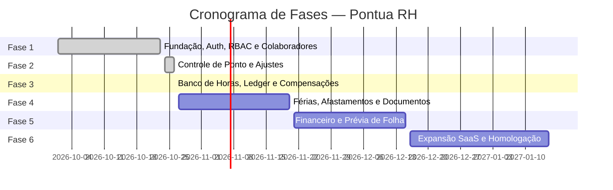

# Roadmap de Desenvolvimento — Pontua RH

Planejamento sequencial e estruturado das etapas de evolução do sistema Pontua RH.

---

## 📍 Faseamento Oficial

---

### 🟢 FASE 1 — Fundação (Status: Concluída)
- [x] Arquitetura de Monorepo com TypeScript e pacotes compartilhados.
- [x] Modelagem do banco de dados relacional com Prisma ORM.
- [x] Sistema de Autenticação com JWT assinado e Hashing de senhas seguro.
- [x] Sistema de Permissões RBAC com controle estrito no Backend e Frontend.
- [x] Isolamento de dados multiempresa (*Multitenancy*).
- [x] Gestão completa de Colaboradores (CRUD, filtros, busca, ativação/desativação).
- [x] Validação oficial de CPF (dígito verificador) e formatações brasileiras.
- [x] Proteção do sigilo salarial por perfil de acesso.
- [x] Layout Administrativo moderno (Sidebar, Header, Tema Claro/Escuro).
- [x] Portal do Colaborador com saudação e visão geral responsiva.
- [x] Testes automatizados de unidade e integração.

---

### 🟢 FASE 2 — Controle de Ponto (Status: Concluída)
- [x] Cadastro e gestão completa de jornadas de trabalho (fixas, flexíveis, 5x2, 6x1, 12x36).
- [x] Registro eletrônico de ponto com timestamp inviolável do servidor e fuso horário.
- [x] Prevenção de duplicidades (< 60s) e preservação estrita de registros originais.
- [x] Histórico de marcações do dia e comprovante eletrônico com hash SHA-256.
- [x] Serviço desacoplado de apuração da jornada (horas trabalhadas, intervalos, tolerâncias).
- [x] Identificação de inconsistências, faltas e marcações incompletas.
- [x] Espelho de ponto mensal com totalizadores e exportação em formato oficial (PDF).
- [x] Fluxo de solicitação de ajustes e inclusão de marcação esquecida pelo colaborador.
- [x] Central administrativa de análise e deliberação com visão restrita para gestores.
- [x] Aplicação de tratamentos homologados sem alteração do registro bruto original.
- [x] Suíte de 27 testes automatizados de unidade, integração e teste E2E completo.
- [x] Documentação técnica de conformidade com a Portaria MTP nº 671/2021 (REP-P).

---

### 🟢 FASE 3 — Banco de Horas, Compensações e Gestão de Jornada (Status: Concluída)
- [x] **Políticas Parametrizáveis**: Regras por empresa e departamento com vigência, tipo de compensação, limite de créditos diários e saldos negativos permitidos.
- [x] **Livro de Movimentações (Ledger Transacional)**: Registro imutável de operações (`CREDITO`, `DEBITO`, `AJUSTE_CREDITO`, `AJUSTE_DEBITO`, `COMPENSACAO`, `TRANSFERENCIA_PAGAMENTO`, `ESTORNO`). Sem deleção física.
- [x] **Cálculo de Saldos em Minutos**: Totalizadores em minutos inteiros derivados exclusivamente das movimentações ativas do ledger.
- [x] **Integração com Apuração de Ponto**: Sincronização atômica ao aprovar ajustes de espelho, recalculando saldo e gerando contrapartidas sem tocar nas marcações brutas originais.
- [x] **Máquina de Estados & Reserva Atômica**: Solicitação de compensação com bloqueio antecipado de saldo (`RESERVADA`) prevenindo consumo concorrente (gasto duplo).
- [x] **Aprovações e Cancelamentos**: Gestores/RH aprovam ou recusam com motivo obrigatório; colaboradores podem cancelar solicitações pendentes liberando o saldo reservado.
- [x] **Liquidação para Folha de Pagamento**: Mecanismo de transferência de saldo positivo para quitação em competência da folha com chave de idempotência e auditoria.
- [x] **Dashboard Administrativo**: Visão consolidada em 5 abas (Saldos por Colaborador, Livro de Movimentações / Extrato, Solicitações de Compensação, Políticas & Acordos, Transferência para Folha).
- [x] **Portal do Colaborador**: Card com saldo disponível vs. reservado, extrato de movimentações, modal de solicitação com validação em tempo real e histórico de solicitações.
- [x] **Testes Automatizados**: 70 testes unitários/integração no backend (18 cenários de negócio da Fase 3) + 2 suítes Playwright E2E completas no navegador.

---

### 🟢 FASE 3.1 — Revisão e Estabilização do Banco de Horas (Status: Concluída)
- [x] **Ciclo de Vida das Compensações (5 Estados)**: Diferenciação entre `RESERVADA`, `APROVADA`, `REALIZADA`, `RECUSADA` e `CANCELADA`. Compensação aprovada para data futura retém a reserva contínua sem débito prematuro no ledger.
- [x] **Confirmação e Realização de Fruição**: Débito consolidado de `COMPENSACAO` no ledger gerado apenas no momento da confirmação da realização, extinguindo a reserva de forma atômica.
- [x] **Cancelamento de Folga Aprovada**: Suporte a cancelamento de compensações previamente autorizadas (`APROVADA`), restituindo imediatamente os minutos reservados ao saldo disponível.
- [x] **Vencimento de Saldos sem Expurgo Automático**: Sinalização de expiração (`isExpired: true`, `expiryNotice`) e proximidade (`daysUntilExpiry <= 30`), com bloqueio estrito de baixas ou expurgo de saldos positivos sem regra administrativa ou negociação sindical validada.
- [x] **Permissões e Visibilidade Estrita de Gestores**: Auditoria e restrição de `GET /api/time-bank/balances`, `GET /api/time-bank/balances/:employeeId` e `GET /api/time-bank/transactions` exclusivamente aos subordinados diretos (`managerId == user.employeeId`), impedindo vazamentos interdepartamentais ou cross-company.
- [x] **Contabilização Idempotente e Recálculo Retroativo**: Sincronização retroativa segura (`syncDayAdjustment`) com estorno auditável de marcações retificadas, sem gerar lançamentos duplicados e protegendo horas enviadas para folha de pagamento.
- [x] **Concorrência e Locks Transacionais**: Bloqueio de linha PostgreSQL (`SELECT ... FOR UPDATE`) em operações financeiras e de reserva, garantindo isolamento ACID contra duplo consumo concorrente de saldo e estorno duplicado.
- [x] **Validação de Idempotência com Detecção de Conflito**: Prevenção de duplicidade com rejeição (`409 Conflict`) em caso de payload conflitante para a mesma chave de idempotência.
- [x] **Proteção contra Duplo Clique Físico**: Verificação de duplicidade por `createdAt` recente, prevenindo que marcações de ajuste retroativo interfiram nas marcações em tempo real.
- [x] **Bateria Completa de Testes**: 70 testes automatizados no vitest cobrindo os 18 cenários de estabilização da Fase 3.1 + fluxo E2E completo de 10 passos no Playwright.

---

### 🟢 FASE 4 — Gestão de Férias, Afastamentos, Atestados e Documentos (Status: Concluída)
- [x] **Acompanhamento de Períodos Contratuais**: Cálculo automatizado de Período Aquisitivo (12 meses, CLT Art. 130) e Concessivo (12 meses subsequentes, CLT Art. 134), com tabela progressiva de redução de dias por faltas injustificadas.
- [x] **Detecção de Riscos e Dobra Legal**: Sinalização de proximidade de vencimento (`daysUntilExpiry <= 60`) e alerta preventivo de dobra da remuneração de férias (CLT Art. 137).
- [x] **Motor de Cálculo de Férias**: Serviço desacoplado e 100% testável com simulação em tempo real de dias de gozo, 1/3 constitucional (CLT Art. 129), abono pecuniário (CLT Art. 143: conversão de até 1/3 ou 10 dias) e prévia preliminar bruta com aviso explícito de apuração líquida definitiva na folha (Fase 5).
- [x] **Fracionamento Trabalhista**: Validação rigorosa do Art. 134 § 1º da CLT: até 3 períodos de fruição, com ao menos um não inferior a 14 dias e nenhum menor que 5 dias corridos.
- [x] **Proteção de Início Pré-DSR**: Validação do Art. 134 § 3º da CLT, vedando o início das férias nos 2 dias antecedentes a descanso semanal remunerado (DSR) ou feriados.
- [x] **Workflow Completo de Solicitações (8 Estados)**: `PENDENTE`, `EM_ANALISE`, `APROVADA`, `PROGRAMADA`, `EM_GOZO`, `CONCLUIDA`, `RECUSADA` e `CANCELADA`. Transições auditadas com deduções atômicas e estorno automático em cancelamentos.
- [x] **Integração com Apuração de Ponto**: Ausências de férias aprovadas/programadas e afastamentos ativos refletem como "Férias Remuneradas (CLT)" ou "Afastamento" no espelho de ponto, suprimindo falsas ocorrências de `Falta Integral` e impedindo débitos indevidos de banco de horas.
- [x] **Prevenção de Conflitos de Agenda**: Bloqueio de solicitações de compensação de banco de horas sobrepostas a períodos de férias ou licenças ativas, e bloqueio de férias concorrentes para o mesmo colaborador.
- [x] **Afastamentos e Licenças**: Gerenciamento de auxílio-doença (empresa até 15d / INSS), acidente de trabalho, licença-maternidade (120d), paternidade, gala/casamento, nojo/luto, alistamento eleitoral, serviço militar e afastamento administrativo com previsão e registro de retorno efetivo.
- [x] **Atestados Médicos com Sigilo Clínico (LGPD & CFM)**: Homologação de atestados com geração automática de licença vinculada e proteção de dados sensíveis (CID-10 restrito estritamente a RH e Medicina do Trabalho).
- [x] **Repositório Digital de Documentos Protegidos**: Upload e download autenticado com RBAC por empresa e colaborador (documentos admissionais, contratuais, avisos de férias, recibos, atestados), fora de diretórios públicos.
- [x] **Dashboard Administrativo**: Visão consolidada em 5 abas (`overview`, `requests`, `leaves`, `certificates`, `documents`) com métricas em tempo real e filtros avançados.
- [x] **Portal do Colaborador**: Interface responsiva para consulta de períodos, simulador de remuneração em tempo real, solicitação com fracionamento/abono, acompanhamento de status, envio de atestado e download seguro de documentos.
- [x] **Testes Automatizados**: 106 testes unitários e de integração no vitest aprovados (20 cenários de férias, CLT e conflitos) + 3 suítes completas de testes E2E no Playwright.

---

### ⚪ FASE 5 — Gestão Financeira e Prévia de Folha
- [ ] Composição da remuneração (salário-base, adicionais, horas extras, benefícios).
- [ ] Apuração de custos de pessoal por departamento e empresa.
- [ ] Prévia de folha de pagamento para conferência mensal.
- [ ] Exportação de relatórios para contabilidade externa.

---

### ⚪ FASE 6 — Expansão SaaS e Homologação
- [ ] Emissão de arquivos fiscais e comprovantes digitais (AFD, AEJ, comprovante do colaborador).
- [ ] Integração com certificação digital ICP-Brasil para assinatura de espelho de ponto.
- [ ] Painel do Super Admin para cobrança, planos e provisionamento automático de tenants.
